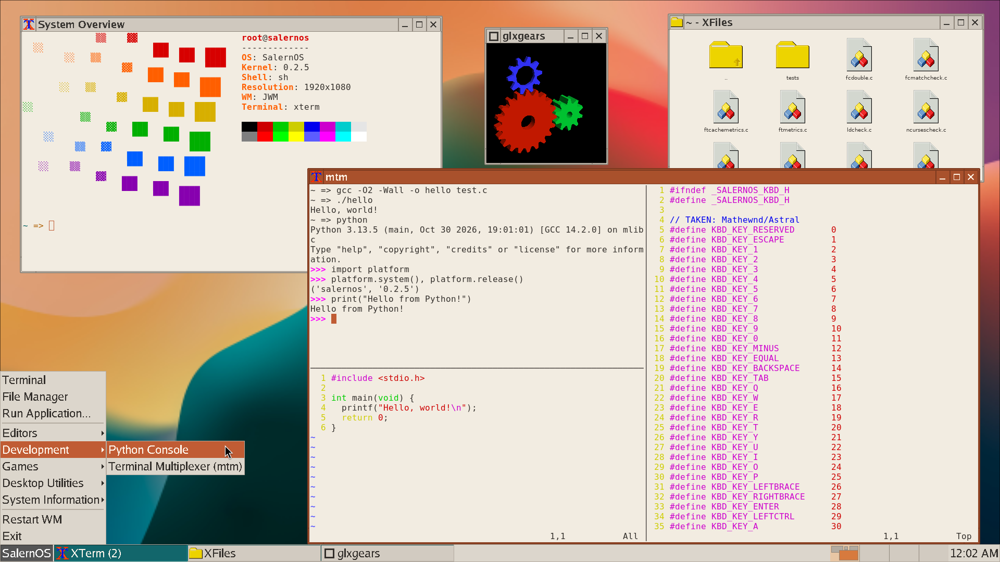
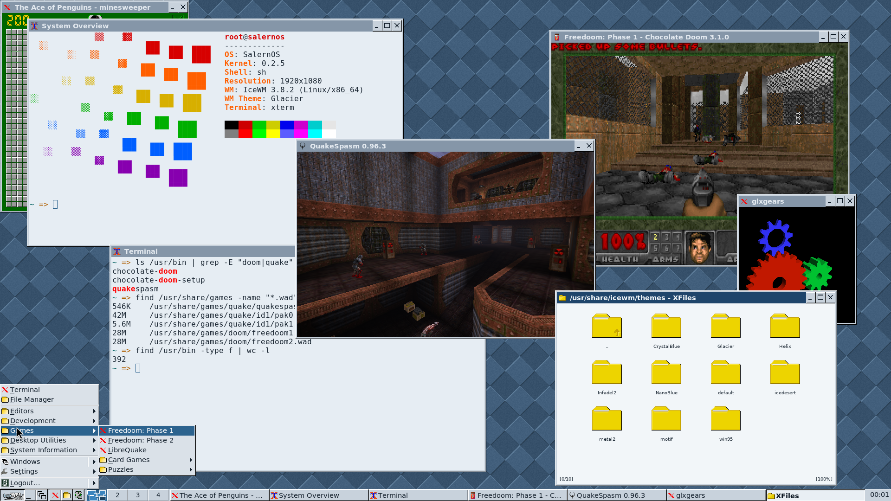

<p align="center">
    <h1 align="center">SalernOS Kernel</h1>
    <p align="center">x86-64 Unix-like kernel</p>
</p>

<div align="center">

[contributors-shield]: https://img.shields.io/github/contributors/Alessandro-Salerno/SalernOS-Kernel.svg?style=flat-square
[contributors-url]: https://github.com/Alessandro-Salerno/SalernOS-Kernel/graphs/contributors
[forks-shield]: https://img.shields.io/github/forks/Alessandro-Salerno/SalernOS-Kernel.svg?style=flat-square
[forks-url]: https://github.com/Alessandro-Salerno/SalernOS-Kernel/network/members
[stars-shield]: https://img.shields.io/github/stars/Alessandro-Salerno/SalernOS-Kernel.svg?style=flat-square
[stars-url]: https://github.com/Alessandro-Salerno/SalernOS-Kernel/stargazers
[issues-shield]: https://img.shields.io/github/issues/Alessandro-Salerno/SalernOS-Kernel.svg?style=flat-square
[issues-url]: https://github.com/Alessandro-Salerno/SalernOS-Kernel/issues
[license-shield]: https://img.shields.io/github/license/Alessandro-Salerno/SalernOS-Kernel.svg?style=flat-square
[license-url]: https://github.com/Alessandro-Salerno/SalernOS-Kernel/blob/master/LICENSE.txt

[![Contributors][contributors-shield]][contributors-url]
[![Forks][forks-shield]][forks-url]
[![Stargazers][stars-shield]][stars-url]
[![Issues][issues-shield]][issues-url]
[![MIT License][license-shield]][license-url]


</div>

<div align="center">
  
  
</div>

## Features
As of kernel release 0.2.5, it is possible to run a variety of programs. Ports for some well-known applications are available in the [SalernOS](https://github.com/Alessandro-Salerno/SalernOS) repository (see credits below). Included are ports for the likes of Xorg, Vim, GNU Coreutils, GCC, GNU Binutils, mlibc, xterm, Python, Doom, Quake, neofetch, xfiles, JWM, IceWM, and more.

The kernel itself roughly includes the following:

- Platform-specific
  - x86-64
    - [x] GDT
    - [x] IDT
    - [x] PIT
    - [x] LAPIC
    - [x] LAPIC Timer 
    - [x] IOAPIC
    - [x] MMU (4-level paging)
    - [x] Invariant TSC
    - [x] PS/2 keyboard & mouse
    - [x] QEMU I/O Port `0xE9` logging 
    - [x] SCE (System Call Extension)
- Common code
  - Memory management
    - [x] PMM
    - [x] Slab allocator
    - [x] VMM (currently being reworrked in a separate tree)
    - [x] Copy-on-write
    - [ ] Buffer cache
  - System management
    - [x] System call interface
    - [x] Callout (Timer multiplexer)
    - [x] ELF loading
    - [x] Interrupt management
    - [x] Kernel panic
    - [x] SMP preemptive scheduler
  - Process management
    - [x] Processes
    - [x] Threads (with userspace API)
    - [x] Job control
  - I/O software interfaces
    - [x] TTY
    - [x] PTY
    - [x] KTTY multiplexing (with userspace API)
    - [x] Kernel log
  - Device abstractions
    - [x] Terminal
    - [x] Keyboard
    - [x] Mouse
  - Pseudo-devices
    - [x] Linux-compatible framebuffer device
    - [x] `/dev/null`
    - [x] `/dev/profile`
    - [ ] `/dev/zero`
    - [ ] `/dev/random`
  - Inter-process communication and synchronization
    - [x] Pipes
    - [x] UNIX domain sockets
    - [x] Signals
    - [x] Futex
    - [x] System V shared memory (implemented in userspace on top of tmpfs)
  - File system
    - [x] VFS
    - [x] initrd
    - [x] iovec (optional)
    - [x] pipefs
    - [x] sockfs
    - [x] tmpfs
    - [x] devfs
    - [ ] ext2
  - Kernel library and data structures
    - [x] Hashmap
    - [x] Radix tree (XArray)
    - [x] Ring buffer
    - [x] Spinlock
    - [x] Mutex
    - [x] RW lock
    - [x] Work queue
    - [x] Iovec iterator
    - [x] libc-like functions
- Compiletime modules (a.k.a., "options", see [src/opt](./src/opt/))
  - [x] [flanterm](https://codeberg.org/Mintsuki/Flanterm)
  - [x] ACPI
  - [x] [uACPI](https://github.com/uACPI/uACPI)
  - [x] PCI/PCIe
  - [x] NVMe (basic 1.0e support)

## History and goals
Development on this Kernel started on December 12, 2021. Since then, the source code has gone through multiple rewrites and has experienced long periods of stagnation. Development resumed in late 2024 after almost two years of inactivity. 

The project's original goal was to learn the basics of operating systems by trying to implement one. Throughout the years, and going into 2025 especially, the kernel acumulated features beyond the original scope, leading to its current state. This allowed the project to aim for greater POSIX compliance, allowing more third-party programs to run.

The work done in 2026 has largely focused on fixing technical debt acumulated through 2024 and 2025, improving both performance and correctness. These changes prepare the kernel for EoL while a new from-scratch design is in the making.

## How to build
### Requirements
- GNU C compatible compiler (like GCC - preferably `<arch>-salernos-mlibc-gcc`)
- Binutils
- NASM (for x86-64)

### Procedure
Simply run the following command and hit enter:
```
make -j8
```
> [!NOTE]
> This will only build the kernel executable for the target architecture (`bin/vmsalernos`). To build the full OS, use the tools in the [SalernOS repository](https://github.com/Alessandro-Salerno/SalernOS).

## License
The SalernOS Kernel is distributed under the GNU General Public License (GPL) v3.0. More details in the [LICENSE](./LICENSE) file.

However, some external componets are included in this repository are distributed under different licenses.
License files for these components can be found in the [licenses](./licenses/) directory and can often be found at the top of related source files.

## Inspiration, acknowledgements, and disclosures
> [!WARNING]
> With no offense to the original authors, I would **strongly discourage** using some of the earlier sources listed here as authoritative foundations for building operating systems. I would also advice people looking for inspiration to pay careful attention to this kernel's own code, as there's a sizable set of known issues that prompted the current out-of-tree rewrite.

- The initial learning material (used in 2021 for versions 0.0.1 - 0.0.3) came from [CodePulses'es YouTube videos](https://www.youtube.com/watch?v=FkrpUaGThTQ)
- The original architecture and structure for many componets written in 2022 (versions 0.0.4 - 0.0.6) came from AbsurdPoncho's YouTube videos, which have since been delisted. The source code written during the series can still be found [here](https://github.com/Absurdponcho/PonchoOS)
- Changes made in 2023 (version 0.1.0) were inspired by the [Lyre](https://github.com/Lyre-OS/klyre) and [qword](https://github.com/qword-os/qword) operating systems
- The current architecture makes use of [Limine](https://github.com/limine-bootloader/limine) and [flanterm](https://github.com/mintsuki/flanterm) by [mintsuki](https://github.com/mintsuki), Kamila Szewczyk, and contributors
- Changes made in late 2024 and early 2025 (versions 0.2.0 - 0.2.4) were parly inspired by the [Astral operating system](https://github.com/Mathewnd/Astral) by [Mathewnd](https://github.com/Mathewnd) and other works
- Changes made since late 2025 are original and part of an attempt to clean up the code before moving to a new foundation
- Some ports in the SalernOS repository are derived or redistributed from ones authored and published by [Gloire](https://github.com/Ironclad-Project/Gloire) and Astral
- Some more recent ports have been written by generative tools

The use of generative AI has been limited. Commits prior to 2024 have no connections to LLMs, and only some commits made after August 2026 include LLM-generated code. In the context of the kernel specifically , these tools have been used to help refactor existing code, find issues, fix bugs, and generally hasten development during the above-mentioned 2026 fix rush. The project remains largely human-written and human-designed, and commit messages explicitly state when LLMs are used for design tasks.
